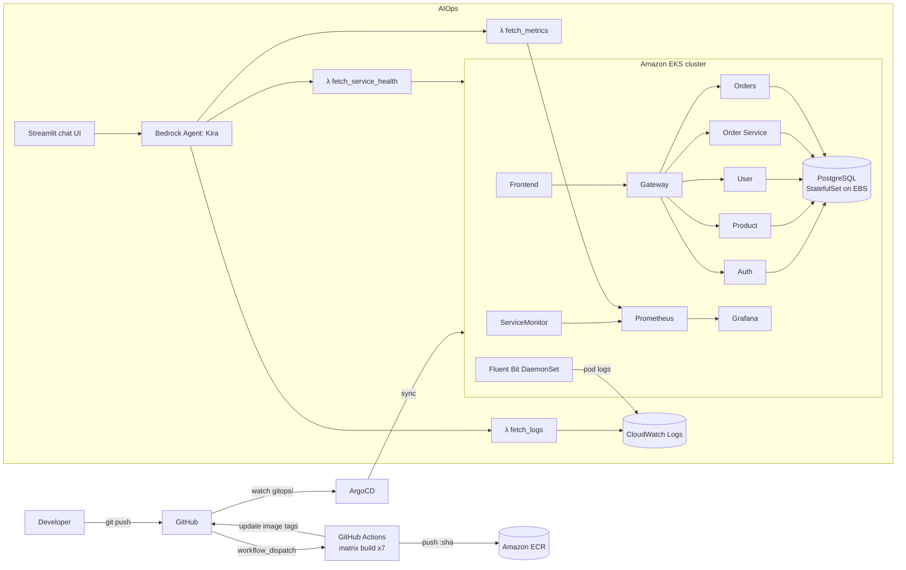

# Agentic AIOps & GitOps Platform on AWS EKS

A production-style DevOps platform that takes a 7-service microservices application from source code to a GitOps-managed Kubernetes cluster on AWS, with full observability and an **AI SRE agent** that diagnoses incidents from live logs, metrics, and cluster health.

     

---

## Highlights

- **Infrastructure as Code:** modular Terraform for VPC (3 AZs), EKS 1.34, ECR, and IAM/OIDC. ArgoCD and kube-prometheus-stack are installed through Terraform's Helm provider.
- **CI/CD + GitOps:** a GitHub Actions matrix pipeline builds 7 images, tags them with the commit SHA, pushes them to ECR, and updates Kustomize manifests. ArgoCD reconciles the cluster to match Git.
- **Observability:** Prometheus ServiceMonitors, PromQL, Grafana dashboards provisioned as code, and Fluent Bit shipping pod logs to CloudWatch.
- **AIOps agent ("Kira"):** an Amazon Bedrock Agent with three Python Lambda tools that pulls logs, metrics, and EKS health, then returns the root cause, evidence, an immediate fix, and prevention steps.
- **AI-assisted operations:** Claude Code with MCP servers for EKS, Terraform, and AWS pricing, plus a `CLAUDE.md` safe-execution policy.

---

## Architecture



### Services

| Service | Port | Responsibility |
|---|---|---|
| Frontend | 3000 | React UI (served by Nginx) |
| Gateway | 3001 | Routes all client requests and exposes `/metrics` |
| Auth | 3002 | Login and registration |
| Product Service | 3003 | Product catalog and inventory |
| Order Service | 3004 | Cart and checkout |
| Orders | 3005 | Order history |
| User Service | 3006 | User profiles |
| PostgreSQL | 5432 | `auth_db`, `products_db`, `orders_db`, `users_db` |

---

## Tech Stack

| Layer | Technology |
|---|---|
| Application | React, Node.js / TypeScript, PostgreSQL |
| Containers | Docker, Docker Compose |
| Orchestration | Kubernetes (Amazon EKS 1.34), EBS CSI driver |
| Infrastructure | Terraform (VPC, EKS, ECR, IAM/OIDC, Helm provider) |
| CI | GitHub Actions to Amazon ECR |
| GitOps | ArgoCD + Kustomize |
| Metrics | Prometheus (kube-prometheus-stack) + Grafana |
| Logs | Fluent Bit to Amazon CloudWatch Logs |
| AIOps | Amazon Bedrock Agents, AWS Lambda (Python 3.12), OpenAPI action groups, Streamlit |
| AI tooling | Claude Code + MCP servers (EKS, Terraform, AWS Pricing) |

---

## Repository Layout

```
.
├── projects/
│   ├── boutique-microservices/   # 7-service app + docker-compose for local dev
│   ├── Infrastructure/           # Terraform: vpc, eks, ecr, argocd modules
│   └── aiops-assistant/          # Bedrock Agent, Lambda tools, OpenAPI schemas, Streamlit UI
├── gitops/
│   ├── argo-cd.yml               # ArgoCD Application
│   ├── kustomization.yml         # Kustomize entry point
│   └── k8s/                      # backend, frontend, database, monitoring manifests
├── docs/                         # system design, workflow, Claude/MCP setup
└── .github/workflows/ci.yml      # build → push → update manifests
```

---

## Deployment

### 1. Run locally

```bash
cd projects/boutique-microservices
docker compose up -d --build
# UI: http://localhost:3000   Grafana: http://localhost:8080
```

### 2. Provision AWS infrastructure

```bash
cd projects/Infrastructure
terraform init
terraform plan
terraform apply
aws eks update-kubeconfig --region us-east-1 --name eks-cluster
```

This creates the VPC, the EKS cluster and node group, the ECR repositories, the IRSA role for the EBS CSI driver, ArgoCD, and kube-prometheus-stack.

### 3. Run the CI pipeline

Add these repository secrets: `AWS_ACCESS_KEY_ID`, `AWS_SECRET_ACCESS_KEY`, `AWS_REGION`, and `AWS_ACCOUNT_ID`. Then trigger **Actions → Boutique CI Pipeline → Run workflow**.

### 4. Deploy with ArgoCD

```bash
kubectl apply -f gitops/argo-cd.yml
kubectl get applications -n argocd
# Once PostgreSQL is Ready, load the seed data:
kubectl apply -f gitops/k8s/database/restore-job.yml
```

### 5. Ship logs to CloudWatch

```bash
helm upgrade --install aws-for-fluent-bit aws/aws-for-fluent-bit \
  -n amazon-cloudwatch --create-namespace \
  --set cloudWatch.enabled=true --set cloudWatch.region=us-east-1 \
  --set cloudWatch.logGroupName=/eks/boutique/pods
```

### 6. Deploy the AIOps agent

```bash
cd projects/aiops-assistant
./setup-iam.sh                 # least-privilege roles for the Lambda tools and the agent
./deploy.sh                    # creates the agent, attaches the 3 action groups, prepares it
cp .env.example .env           # set BEDROCK_AGENT_ID
pip install -r requirements.txt
streamlit run app.py
```

---

## AIOps Agent: How Kira Works

Kira follows an SRE incident workflow: **symptom → hypothesis → evidence → diagnosis → fix and prevention**.

| Tool (Lambda) | Data source | Example use |
|---|---|---|
| `fetch_logs` | CloudWatch Logs (`/eks/boutique/pods`) | "Show 5xx errors from the gateway in the last hour" |
| `fetch_metrics` | Prometheus (PromQL) | Request rate, p95 latency, error rate, pod CPU and memory |
| `fetch_service_health` | EKS API + Prometheus | Node group status, pod restarts, services that are down |

Each tool is described by an OpenAPI schema, so the agent decides on its own which tools to call and in what order.

<!-- Add a screenshot of a real diagnosis here, e.g. docs/images/kira-diagnosis.png -->

---

## Observability

Useful PromQL queries:

```promql
sum by (job) (rate(http_requests_total[5m]))                                        # request rate
histogram_quantile(0.95, sum by (le, job) (rate(http_request_duration_seconds_bucket[5m])))  # p95 latency
sum by (job) (rate(http_requests_total{status_code=~"5.."}[5m]))                    # 5xx rate
increase(kube_pod_container_status_restarts_total{namespace="boutique"}[1h])        # pod restarts
```

The Grafana dashboard is stored as a ConfigMap labelled `grafana_dashboard: "1"`, and the Grafana sidecar imports it automatically.

<!-- Add screenshots: Grafana dashboard, ArgoCD sync view -->

---

## Troubleshooting Log

| Problem | Root cause | Fix |
|---|---|---|
| Pods stuck in `Pending` ("too many pods") after scaling replicas | ENI-based pod-density limit on `t3.medium` (17 pods per node) | Right-sized the nodes to a larger instance type with a higher pod limit |
| EBS volume failed to attach | EKS 1.32+ requires IRSA for the EBS CSI driver | Created an IRSA role with `AmazonEBSCSIDriverPolicy` in Terraform |
| PostgreSQL skipped the init script, so the app showed "product_db does not exist" | A new EBS volume contains `lost+found`, so Postgres treats the data directory as already initialized | Added a Kubernetes **restore Job** that runs after the database pod is Ready |
| No application metrics in Grafana | The ServiceMonitor wasn't matching or scraping the app's `/metrics` endpoint | Fixed the ServiceMonitor selector and port, and labelled the gateway Service |

---

## Security Notes

- CI uses repository secrets. No credentials are stored in the workflow file.
- EKS workloads use IRSA. The Lambda tools and the Bedrock Agent each have their own least-privilege IAM role.
- Planned improvements: use OIDC federation for GitHub Actions instead of access keys, move to External Secrets Operator or Sealed Secrets, and add Trivy image scanning and Gitleaks pre-commit hooks to CI.

---

## Cost & Teardown

The EKS control plane, the node group, and the load balancers cost money while they run. Tear everything down when you're finished:

```bash
kubectl delete -f gitops/argo-cd.yml
cd projects/Infrastructure && terraform destroy
```

---

## Author

**Shravan Kumar**, DevOps Engineer · [LinkedIn](https://linkedin.com/in/imshravankumar) · [GitHub](https://github.com/Shravan-kumar00)
